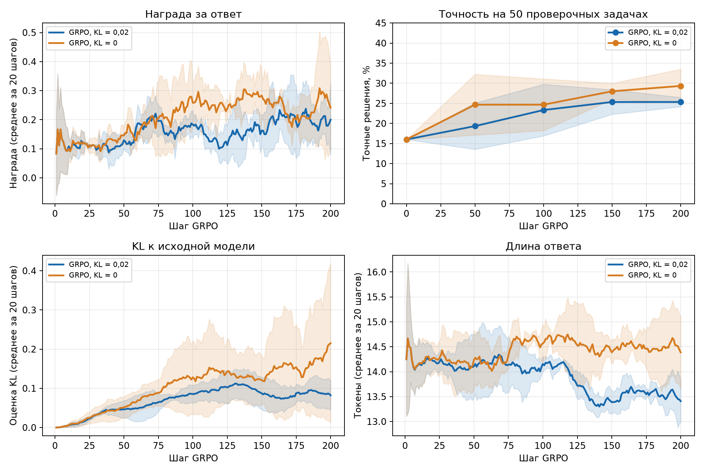

# Влияет ли KL-штраф на RL-дообучение языковой модели?

Сессионное задание по обучению с подкреплением. **Трек 3: RL-дообучение языковой модели.**

Модель Qwen3-0.6B и задачу с арифметическими выражениями. Модель получает три числа и цель. 

Нужно использовать каждое число ровно один раз и получить цель с помощью `+`, `-`, `*`, `/` и скобок.

## Вопрос и гипотеза

Вопрос: **что меняет штраф за уход от исходной модели при GRPO-обучении?** Я сравнил обучение с KL-штрафом `0,02` и без него. Гипотеза: KL-штраф поможет модели чаще соблюдать правило об использовании всех чисел и уменьшит её отклонение от исходной модели. При этом точность решения может расти медленнее.

Сначала я сделал пробный запуск и проверил его на отдельном наборе `test.jsonl`. После этого зафиксировал новый итоговый набор `final_test.jsonl` из 220 задач. Он не использовался для обучения или настройки. Для сравнения условий я не менял число шагов, награду, модель и другие параметры. Я добавил ещё два seed, чтобы проверить, насколько результат зависит от случайного запуска. Выводы сделаны по итоговому набору.

## Задача и проверка ответа

Числа - три разных целых числа от 2 до 12. Цель находится в диапазоне от 5 до 60. Генерировались только задачи, у которых точно есть решение. Задачи не повторяются между наборами:

| Набор | Число задач | Для чего нужен |
| --- | ---: | --- |
| `train.jsonl` | 400 | Обучение |
| `dev.jsonl` | 50 | График точности во время обучения |
| `test.jsonl` | 220 | Пробный этап, не входит в итоговые выводы |
| `final_test.jsonl` | 220 | Окончательное сравнение моделей |

Ответ должен иметь только вид `<answer>выражение</answer>`. Награда равна **1**, только если выражение даёт точную цель и использует каждое исходное число ровно один раз. Во всех остальных случаях награда **0**. Проверка находится в [`track3/task.py`](track3/task.py). Она разбирает выражение как дерево и считает дроби точно через `Fraction`. Вызова `eval` нет. Лишний текст, повтор чисел, подстановка другого числа и деление на ноль отклоняются. Примеры таких проверок есть в [`track3/test_task.py`](track3/test_task.py).

## Модель и условия

Исходная модель - [Qwen3-0.6B](https://huggingface.co/Qwen/Qwen3-0.6B), снимок `c1899de289a04d12100db370d81485cdf75e47ca`. В загруженной модели около 597 млн параметров. Режим длинных рассуждений отключён. Я обучал только LoRA-адаптер: 1 146 880 параметров, или 0,192% модели. Обучение и проверку провёл на MacBook Pro M4 с 16 ГБ памяти.

Я реализовал упрощённый GRPO в [`track3/train_grpo.py`](track3/train_grpo.py). На каждом шаге модель даёт четыре ответа на одну задачу. Я сравниваю их награды внутри группы и обновляю LoRA один раз. Также считаю оценку KL к исходной модели по токенам этих ответов. Для общего описания метода я опирался на [документацию GRPO](https://huggingface.co/docs/trl/grpo_trainer); библиотеку TRL в коде не использовал.

| Условие | Обучение | KL-штраф |
| --- | --- | ---: |
| Исходная модель | Нет | — |
| GRPO с KL | 200 шагов | 0,02 |
| GRPO без KL | 200 шагов | 0 |

У двух обученных условий совпадают модель, данные, seed, награда, LoRA, число шагов и способ генерации. Отличается только коэффициент KL. Я сделал три парных запуска с seed `20261114`, `20261115`, `20261116`. В каждом запуске было `200 × 4 = 800` сгенерированных ответов. Для LoRA использовал `r=8`, скорость обучения `5e-5`. Во время обучения температура генерации `0,8`, `top_p=0,95`, максимум 64 новых токена. При проверке ответы получены без случайной выборки. Для всех моделей использованы одни и те же 220 итоговых задач.

## Результаты



На графиках линии показывают среднее по трём seed, светлая область - стандартное отклонение между ними. Награда, оценка KL и длина ответа сглажены по 20 шагам. Точность измерялась на 50 проверочных задачах после 0, 50, 100, 150 и 200 шагов. Оценка KL получена по сгенерированным ответам, поэтому это **не точный KL по всем возможным ответам**.

Итог на 220 новых задачах:

| Модель | Точные решения | Все числа использованы верно | Средняя длина ответа |
| --- | ---: | ---: | ---: |
| Исходная | 39/220 = 17,7% | 95,0% | 14,05 токена |
| GRPO с KL | 23,5% ± 0,7% | 98,9% ± 0,9% | 13,51 ± 0,07 токена |
| GRPO без KL | 27,9% ± 4,2% | 79,7% ± 20,4% | 14,15 ± 0,51 токена |

Для обученных моделей указаны среднее и стандартное отклонение **по трём seed**. Результаты каждого запуска:

| Seed | С KL | Без KL |
| --- | ---: | ---: |
| 20261114 | 53/220 = 24,1% | 64/220 = 29,1% |
| 20261115 | 52/220 = 23,6% | 69/220 = 31,4% |
| 20261116 | 50/220 = 22,7% | 51/220 = 23,2% |

По сравнению с исходной моделью средняя точность выросла на **5,8 процентного пункта** с KL и на **10,2 пункта** без KL. В среднем вариант без KL выше на 4,4 пункта, но разница между вариантами сильно меняется по seed: от 0,5 до 7,7 пункта. Трёх seed мало, чтобы уверенно утверждать, что вариант без KL всегда точнее.

На последних 50 шагах средняя оценка KL составила **0,083 ± 0,030** с KL-штрафом и **0,176 ± 0,152** без него. Средняя награда за сгенерированный ответ была **0,205 ± 0,031** и **0,237 ± 0,072** соответственно. Это показатели обучения, а итоговую точность я считал отдельно на новых задачах.

## Примеры ответов и ошибок

Здесь приведены ответы моделей с seed `20261114` на одни и те же задачи. **Жирным** отмечено правильное выражение.

| Числа, цель | Исходная модель | GRPO с KL | GRPO без KL |
| --- | --- | --- | --- |
| `3, 5, 8 → 16` | `3+5*8` | **`8+5+3`** | **`8+5+3`** |
| `2, 5, 8 → 21` | `2+5*8` | `5*2+8` | **`8*2+5`** |
| `4, 5, 10 → 30` | **`4*5+10`** | **`4*5+10`** | `10*3` — использовано число 3, которого не было в задаче |

Я отдельно проверил возможный обход награды: модель не может получить балл за готовое число без выражения, повтор чисел, два ответа, произвольный код или деление на ноль. В итоговых результатах я не нашёл успешного обхода проверки. Однако вариант без KL с seed `20261114` дал **92 ответа из 220** с неверным набором чисел. Все они получили награду 0. У остальных seed эта ошибка встречалась 34 и 6 раз. С KL таких ошибок было 4, 3 и 0.

## Вывод и ограничения

Гипотеза о соблюдении правил подтвердилась: KL-штраф уменьшил отклонение от исходной модели, и ответы почти всегда использовали нужные числа. Без KL средняя точность оказалась выше, но результаты сильнее зависели от seed, а число недопустимых выражений заметно выросло в двух запусках. Поэтому я бы выбрал вариант с KL, если важно надёжно соблюдать правила задачи. Если важнее только доля точных решений в этом тесте, вариант без KL выглядит лучше.

Это исследование ограничено одной маленькой моделью, простыми автоматически созданными задачами и тремя seed. Разница точности между двумя вариантами обучения небольшая по сравнению с её разбросом. На других задачах и при большем числе шагов результат может измениться.

## Как повторить

Нужны Python 3.12 и GPU. Точные версии библиотек — в [`track3/requirements.txt`](track3/requirements.txt). Код автоматически использует CUDA, Apple MPS или CPU; на CPU обучение будет гораздо дольше.

```bash
cd track3
python3.12 -m venv .venv
source .venv/bin/activate
python -m pip install -r requirements.txt
bash run_all.sh
```

Скрипт [`track3/run_all.sh`](track3/run_all.sh) проверяет набор задач, заново оценивает исходную модель, обучает шесть адаптеров, оценивает их и строит графики. Новый запуск сохраняется в `track3/rerun/`. Уже полученные ответы, журналы обучения, адаптеры и сводка лежат в [`track3/results/`](track3/results/). Веса исходной модели скачиваются при первом запуске и в GitHub-репозиторий не входят.
