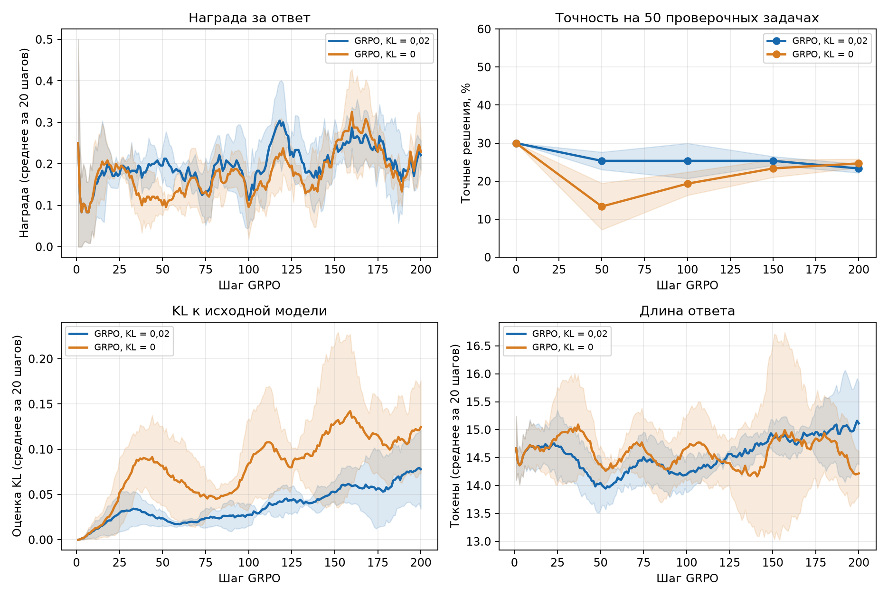

# Влияет ли KL-штраф на RL-дообучение языковой модели?

Сессионное задание по обучению с подкреплением. **Трек 3: RL-дообучение языковой модели.**

Я взял Qwen3-0.6B и задачу с арифметическими выражениями. Модель получает три числа и цель. Нужно использовать каждое данное число ровно один раз и получить цель с помощью `+`, `-`, `*`, `/` и скобок. Числа могут повторяться: например, для `3, 3, 5` нужны две тройки и одна пятёрка.

## Вопрос и гипотеза

Мой вопрос: **как KL-штраф влияет на точность и соблюдение правил при GRPO-обучении?** Я сравнил коэффициенты KL `0,02` и `0`. Гипотеза: штраф уменьшит отклонение от исходной модели и число ответов с неверным набором чисел. При этом точность может расти медленнее.

Раньше я провёл пробный эксперимент. В нём итоговый набор и дополнительные seed были выбраны уже после первых запусков. Поэтому для этого отчёта я заново провёл весь цикл. **До первой оценки модели и до обучения** я сохранил новые выборки, три seed, настройки и SHA-256 файлов в [протоколе](track3/experiments/2026-11-18/protocol.json). Протокол отправлен на GitHub коммитом [`87973e8`](https://github.com/MaximTrofimenko/reinforcement-learning-grpo/commit/87973e81cb5e33975e5048acbc58d9b19fbaf70f). Порядок этапов записан в [журнале запуска](track3/experiments/2026-11-18/results/run_journal.jsonl). Ниже приведены только результаты нового цикла.

## Задачи и проверка ответа

Исходные числа находятся в диапазоне 2–12, цель — 5–60. Я генерировал только задачи с решением. Seed подготовки данных — `20261118`.

| Набор | Число задач | Назначение |
| --- | ---: | --- |
| `train.jsonl` | 400 | Обучение |
| `dev.jsonl` | 50 | Промежуточная проверка |
| `final_test.jsonl` | 220 | Итоговое сравнение |

Все новые выборки лежат в [папке данных](track3/experiments/2026-11-18/data/) и не пересекаются между собой. В итоговой выборке нет задач ни из одной старой выборки. Чтобы получить достаточно новых задач, я разрешил повторяющиеся числа. Учебный и проверочный наборы могут содержать задачи прежнего исследования.

Ответ должен иметь вид `<answer>выражение</answer>`. Награда равна **1**, если выражение даёт точную цель и каждое данное число использовано нужное число раз. Иначе награда **0**. [Проверка ответа](track3/task.py) разбирает выражение как дерево и считает дроби через `Fraction`. Вызова `eval` нет. Лишний текст, неправильный набор чисел и деление на ноль отклоняются.

## Модель и обучение

Использована [Qwen3-0.6B](https://huggingface.co/Qwen/Qwen3-0.6B), снимок `c1899de289a04d12100db370d81485cdf75e47ca`. В исходной модели около **596 млн параметров**, что меньше 1,5 млрд. С добавленным LoRA-адаптером — 597 196 800 параметров. Обучаются только **1 146 880 параметров LoRA**, около 0,192%. Длинные рассуждения отключены через `enable_thinking=False`. Расчёт выполнен на MacBook Pro M4 с 16 ГБ памяти.

Я реализовал [упрощённый GRPO](track3/train_grpo.py) самостоятельно. На каждом шаге модель генерирует четыре ответа на одну задачу. Награды сравниваются внутри группы, затем выполняется одно обновление LoRA. Для оценки KL используется исходная модель с отключённым адаптером. Для общего описания метода я использовал [документацию GRPO](https://huggingface.co/docs/trl/grpo_trainer).

| Настройка | Значение |
| --- | --- |
| Seed обучения | `20261118`, `20261119`, `20261120` |
| Условия | KL `0,02` и KL `0` для каждого seed |
| Число шагов | 200 в каждом запуске |
| Ответов на шаг | 4 |
| LoRA | `r=8`, `alpha=16`, dropout `0` |
| Скорость обучения | `5e-5` |
| Генерация при обучении | температура `0,8`, `top_p=0,95` |
| Ограничение ответа | 64 новых токена |

В каждой паре запусков отличается только коэффициент KL. Всего выполнено шесть обучений, по 800 сгенерированных ответов в каждом. Проверка на `dev` проводится каждые 50 шагов. Для итоговой оценки я всегда брал адаптер после 200 шагов, без выбора лучшего чекпойнта.

## Базовая модель и итоговая проверка

**До обучения** базовая модель решила **54 из 220 задач — 24,5%**. Это входит в требуемый диапазон 10–50%, поэтому сложность после этой проверки я не менял.

Базовая модель и все шесть адаптеров проверены на одних и тех же **220 задачах при жадном декодировании**: `do_sample=False`, `num_beams=1`, максимум 64 новых токена. Сначала завершены все обучения, затем оценены все адаптеры на итоговом наборе. Гиперпараметры по этим результатам не менялись.

## Результаты



Линии показывают среднее по трём seed, светлая область — стандартное отклонение между ними. Награда, оценка KL и длина ответа сглажены по 20 шагам. Точность на графике измерена на 50 задачах `dev`. Итоговые показатели ниже посчитаны отдельно на 220 задачах `final_test`.

| Модель | Точные решения | Верный набор чисел | Средняя длина ответа |
| --- | ---: | ---: | ---: |
| Исходная | 54/220 = 24,5% | 90,9% | 14,10 токена |
| GRPO с KL | 29,5 ± 2,7% | 77,9 ± 17,8% | 15,23 ± 0,66 токена |
| GRPO без KL | 32,1 ± 0,5% | 83,8 ± 11,1% | 14,33 ± 0,67 токена |

Для обученных моделей указаны среднее и выборочное стандартное отклонение по трём seed.

| Seed | С KL | Без KL |
| --- | ---: | ---: |
| 20261118 | 65/220 = 29,5% | 70/220 = 31,8% |
| 20261119 | 59/220 = 26,8% | 72/220 = 32,7% |
| 20261120 | 71/220 = 32,3% | 70/220 = 31,8% |

Изменение средней точности относительно исходной модели: **5,0 процентного пункта с KL** и **7,6 пункта без KL**. В среднем вариант без KL выше на 2,6 пункта. Парная разница «без KL минус с KL» меняется от -0,5 до 5,9 пункта. Трёх seed мало для уверенного общего вывода о преимуществе одного условия.

На последних 50 шагах средняя оценка KL составила **0,066 ± 0,034** со штрафом и **0,114 ± 0,038** без него. Средняя награда за ответ: **0,228 ± 0,020** и **0,235 ± 0,030**. Оценка KL считается по сгенерированным ответам и не является точным KL по всем возможным ответам.

## Примеры ответов и ошибок

Примеры для seed `20261118`. Жирным выделены правильные ответы.

| Числа и цель | Исходная модель | С KL | Без KL |
| --- | --- | --- | --- |
| `2, 2, 5 → 9` | `2 + 2 * 5` | **`2 + 2 + 5`** | **`2 + 2 + 5`** |
| `4, 7, 7 → 18` | `4 + 7 * 7` | `4 + 7 + 7 = 18` | **`7 + 7 + 4`** |
| `5, 5, 5 → 30` | `5 + 5 + 5` | `5 + 5 + 5 + 5 + 5 + 5` | **`5*5 + 5`** |

Число ответов, не прошедших проверку набора чисел, по трём seed: **77, 65, 4 с KL** и **14, 62, 31 без KL**. В первое число также входят 10 ответов с ошибкой формата, в которых проверка чисел не выполнялась. Остальные случаи — неверное количество или состав чисел. Все такие ответы получили нулевую награду. Я повторно проверил сохранённые ответы, включая случаи с повторяющимися числами.

## Вывод и ограничения

Оба варианта повысили среднюю точность относительно исходной модели. Без KL результат в среднем выше на 2,6 процентного пункта, но для одного seed вариант с KL оказался немного точнее.

Гипотеза подтвердилась частично. KL-штраф уменьшил среднюю оценку отклонения от исходной модели, но не помог соблюдать правило о числах. Верный набор чисел получили 77,9% ответов с KL, 83,8% без KL и 90,9% у исходной модели. В этом эксперименте рост точности сопровождался увеличением числа недопустимых ответов.

При этих настройках я бы выбрал вариант без KL: он дал более высокую среднюю точность и меньше нарушений правила о числах. Трёх seed и одной задачи недостаточно, чтобы переносить этот вывод на другие условия.

Исследование ограничено одной небольшой моделью, 200 шагами обучения и тремя seed. В итоговой выборке **205 из 220 задач содержат повторяющиеся числа**, а в учебной — 91 из 400. Это связано с исключением всех ранее использованных задач. Поэтому эти результаты относятся прежде всего к задачам с повторяющимися числами. Их нельзя напрямую сравнивать с процентами из старого эксперимента.

## Как повторить

Нужен Python 3.12. Для обучения я использовал GPU Apple MPS; код также поддерживает CUDA и CPU. Полный новый цикл занял около 64 минут. На CPU расчёт займёт больше времени. Версии библиотек указаны в [requirements.txt](track3/requirements.txt).

```bash
cd track3
python3.12 -m venv .venv
source .venv/bin/activate
python -m pip install -r requirements.txt
python run_experiment.py --output-dir rerun/2026-11-18
```

Скрипт проверяет хеши файлов из протокола, оценивает базовую модель, выполняет шесть обучений и итоговые проверки, затем строит графики. Существующие результаты не перезаписываются. Веса исходной модели скачиваются при первом запуске.

Сохранённые ответы, журналы и адаптеры нового цикла находятся в [папке результатов](track3/experiments/2026-11-18/results/), сводка — в [summary.json](track3/experiments/2026-11-18/results/summary.json). Проверка этих файлов без загрузки модели: `python verify_experiment.py`. Старые результаты сохранены в [track3/results](track3/results/) как пробный эксперимент и в итоговые таблицы этого отчёта не входят.
